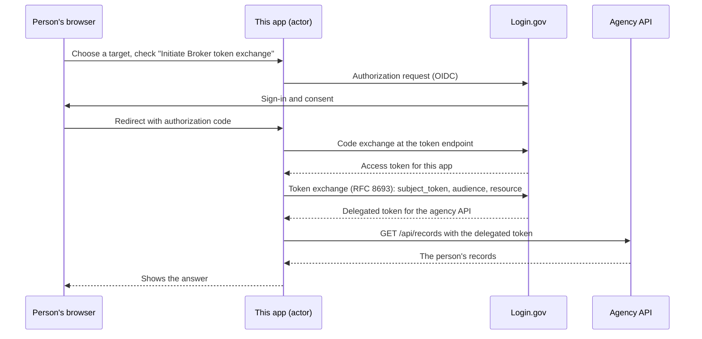
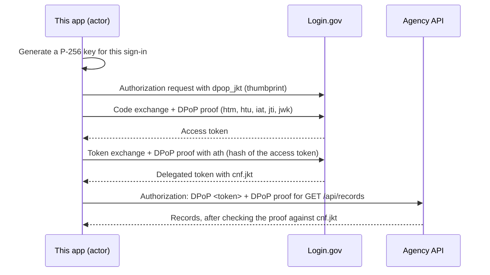

# identity-openidconnect-sinatra

An example of a Relying Party for OpenID Connect written as a simple Sinatra app in Ruby.

## Running locally

1. Set up the environment with:

  ```
  $ make setup
  ```

2. And run the app server:

  ```
  $ make run
  ```

3. To run specs:

  ```
  $ make test
  ```

## Configuring

1. This sample service provider is configured to run on http://localhost:9292 by default. Optionally, you can assign a custom hostname or port by passing `HOST=` or `PORT=` environment variables when starting the application server. However, when you do this, you also have to make corresponding changes to the `redirect_uri` environment variable and also configure the identity provider appropriately.

2. Some other key environment variables that affect configuration:

   | Environment Variable        | Description                                                                                  | Default                                   |
   |-----------------------------|----------------------------------------------------------------------------------------------|-------------------------------------------|
   | client_id                   | Identifier for this app as configured with the identity provider. Used unless `PKCE` is true | urn:gov:gsa:openidconnect:sp:sinatra      |
   | client_id_pkce              | Identifier for this app as configured with the identity provider. Used if `PKCE` is true     | urn:gov:gsa:openidconnect:sp:sinatra_pkce |
   | eipp_allowed                | Enhanced In Person Proofing allowed                                                          | false                                     |
   | idp_url                     | URL for the identity provider                                                                | http://localhost:3000                     |
   | DPOP                        | With `PKCE`, binds the sign-in and the delegated token to a key held for the sign-in (RFC 9449): `dpop_jkt` on the authorization request and a `DPoP` proof on every token request | false                                     |
   | PKCE                        | Determines if PKCE or private_key_jwt is used to communicate with the identity provider      | false                                     |
   | third_party_target_link_allowlist | Exact origins an actor application may name in `target_link_uri` when it starts a sign-in here through `GET /initiate_login` (space- or comma-separated) | http://localhost:9292 |
   | third_party_sign_in_ial     | The identity assurance level this target application signs people in at when a third party starts the sign-in | 2                                         |
   | token_exchange_targets      | JSON list of agency applications to delegate to: `issuer` (the `audience`), `scope` (the `token_exchange:` value) and `api` (the `resource`) | one fictitious target                     |
   | semantic_ial_values_enabled | Determines if semantic IAL values can be used in `acr_values`                                | fals                                      |

## Delegated access

This demo app plays two roles: the **actor**, the service a person signs in to (say, MyBenefits Assistant), which asks
Login.gov for a token it can use to call an agency's API on that person's behalf, and the **agency API** itself (the
target application, say Housing Assistance Records), which receives that token and decides whether to answer. The actor
role is turned on by checking "Initiate Broker token exchange" on the home page and requesting a `token_exchange:<value>`
scope, with `DPOP=true` (together with `PKCE=true`) adding key binding; the agency role is just this app running as the
target service, where `third_party_target_link_allowlist` and `third_party_sign_in_ial` govern the sign-ins it accepts
from another site (see [the target application side](#third-party-initiated-login-the-target-application-side)).

### Getting a token for an agency API (token exchange)

The person signs in to this app with Login.gov in the ordinary way, described in
[Login.gov's OpenID Connect developer documentation](https://developers.login.gov/oidc/). The app trades the
authorization code for an access token. It then goes back to Login.gov's token endpoint and trades that access token for
a different one: a delegated token for the agency API named by the `token_exchange:<value>` scope. This second trade is
an OAuth 2.0 token exchange ([RFC 8693](https://www.rfc-editor.org/rfc/rfc8693)). The sign-in token is the
`subject_token`; the agency application's issuer is the `audience` and its API URL is the `resource`, both read from the
matching entry in `token_exchange_targets`. The delegated token names the person (`sub`) and the actor acting for them
(`act`). The "Target" page then offers to send it to the agency API, and shows what the API answers.



### Binding the tokens to a key (DPoP)

A plain bearer token works for whoever holds it: if it leaks from the browser, a log or a proxy, the thief can use it.
With `DPOP=true` (and `PKCE=true`) the app binds its tokens to a private key it keeps for the sign-in, following
[RFC 9449](https://www.rfc-editor.org/rfc/rfc9449). Every use of the token must then come with a fresh signature from
that key, so a copied token is useless on its own. The steps are:

1. **Make a key and announce it.** The app generates a P-256 key for each sign-in and puts the key's thumbprint on the
   authorization request as `dpop_jkt`, so Login.gov knows from the start which key the tokens belong to
   ([RFC 9449 §10](https://www.rfc-editor.org/rfc/rfc9449#section-10)).
2. **Prove the key on every token request.** Each request to Login.gov's token endpoint carries a `DPoP` header: a short
   signed JWT naming the request's method and URL, the time, a one-time `jti`, and the public key
   ([§4.1](https://www.rfc-editor.org/rfc/rfc9449#section-4.1), [§4.2](https://www.rfc-editor.org/rfc/rfc9449#section-4.2)).
   The proof on the token exchange also carries `ath`, a hash of the access token being traded in
   ([§4.2](https://www.rfc-editor.org/rfc/rfc9449#section-4.2)).
3. **Receive a bound token.** The delegated token Login.gov returns carries `cnf.jkt`, the thumbprint of the same key
   ([§6.1](https://www.rfc-editor.org/rfc/rfc9449#section-6.1)). Because a browser redirect cannot sign anything, the
   app no longer hands the token to the agency API through the browser; it calls the API itself.
4. **Present it with a proof.** The call to the agency API sends the token as `Authorization: DPoP <token>` with a `DPoP`
   proof made for that exact request ([§7.1](https://www.rfc-editor.org/rfc/rfc9449#section-7.1)). The sign-in token is
   presented to `userinfo` the same way.



### When the person has no account at the agency (third-party-initiated login)

Login.gov can only delegate to an agency the person has already connected their account with. If they have not,
Login.gov refuses the exchange with `invalid_target` and, when the agency has registered one, an `initiate_login_uri`.
A delegation request never creates the account; the person has to sign in at the agency first. So the actor hands the
browser to the agency's login-initiation address (`GET /initiate_login` in this sample) using third-party-initiated
login ([OpenID Connect Core 1.0 §4](https://openid.net/specs/openid-connect-core-1_0.html#ThirdPartyInitiatedLogin))
with three parameters: `iss` (Login.gov's URL), a fresh `login_hint` (an opaque value this app will recognize on the
way back) and `target_link_uri=/third_party/return` (where to send the person afterwards). The agency runs its own
Login.gov sign-in; the person already has a Login.gov session, so they are not asked for credentials again. The agency
then returns the person to `/third_party/return` with the same `login_hint` and `status=signed_in`, and this app repeats
the delegation request exactly as it was first made. The exchange now succeeds.

The return is honored once, within ten minutes, and only for the hand-off this browser session started; a return with
an unknown hint, an expired hand-off or any other `status` is shown as an error. A refusal that carries no
`initiate_login_uri` is shown as the delegation's error.

```mermaid
sequenceDiagram
    participant B as Person's browser
    participant A as This app (actor)
    participant L as Login.gov
    participant T as Agency (target application)
    A->>L: Token exchange for the agency
    L-->>A: invalid_target + initiate_login_uri
    A->>B: Redirect to the agency's GET /initiate_login?iss=...&login_hint=...&target_link_uri=.../third_party/return
    B->>T: GET /initiate_login
    T->>L: The agency's own Login.gov sign-in (existing session, no new credentials)
    L-->>T: Signed in; the account is now connected to the agency
    T->>B: Redirect to target_link_uri?login_hint=...&iss=<agency>&status=signed_in
    B->>A: GET /third_party/return
    A->>L: The same token exchange again
    L-->>A: Delegated token
```

### What the agency API checks (GET /api/records)

`GET /api/records` is the agency side of the sample. It reads the token from the `Authorization` header and, in this
order:

1. **Decrypts it** with the service's private key (`sp_private_key_path`); the delegated token is a JWE encrypted to
   this agency, so no one else can read it.
2. **Verifies Login.gov's signature** on the token inside, against the keys Login.gov publishes at its JWKS address.
3. **Checks who issued it and who it is for**: `iss` must be Login.gov and `aud` must be this service's `client_id`
   ([RFC 7519 §4.1](https://www.rfc-editor.org/rfc/rfc7519#section-4.1)).
4. **Checks the DPoP proof when the token carries `cnf.jkt`**: the `DPoP` header must be a proof signed by the key with
   that thumbprint, for this method and URL, recent (within five minutes), with an `ath` matching the token presented
   ([RFC 9449 §4.3](https://www.rfc-editor.org/rfc/rfc9449#section-4.3)).
5. **Refuses a bound token presented as `Bearer`** ([RFC 9449 §7.1](https://www.rfc-editor.org/rfc/rfc9449#section-7.1)),
   answering `401` with a `WWW-Authenticate: DPoP` challenge. A token without `cnf` is an ordinary bearer token and is
   accepted under the `Bearer` scheme only.

The sample keeps no record of the proof identifiers (`jti`) it has seen. A deployed agency API must, so that a captured
proof cannot be replayed within the acceptance window.

## Encrypted userinfo responses and document images

The identity provider can return data from the userinfo request as a JWE (content type `application/jwt`) instead of
plain JSON. The app detects the content type and decrypts the response with the private key at `sp_private_key_path`,
the same key that signs its `private_key_jwt` client assertion.

The decrypted claims are shown on the home page exactly as plain claims are. With the `document_images` scope (offered
as a checkbox when the identity provider allow-lists this client for it), they include `document_metadata` and
`document_images`, whose values are the URLs of the images (`front`, `back`, `passport`, `selfie`). The "Test document
artifacts" page decrypts the same way and reports `encrypted` with each check.

### Document images

After sign-in the app fetches each URL in `document_images` and shows the image inline with its media type and size.
Each fetch is a `POST` to the URL with the bearer access token in `Authorization` and a `private_key_jwt` client
assertion (`client_assertion` and `client_assertion_type`) whose `aud` is exactly the URL requested. The identity
provider answers with a JWE with content type `application/jose`; its `cty` header names the image's media type. The
app decrypts the JWE with its private key.

Errors are:

- 401 `invalid_client` (assertion missing or invalid),
- 403 (sharing not authorized for this sign-in),
- 404 (no such image yet),
- 500 `server_error` (the client has no usable certificate to encrypt to).

An image that fails is shown as its error beside the others. The images live in the process's memory for one page
view. The test page's image checks make the same request and report the status, the headers, whether the response was
encrypted, and the image's type and size.

## Third-party-initiated login (the target application side)

`GET /initiate_login` is the login-initiation address this sample application registers (OpenID Connect Core 1.0 §4). An
actor application whose delegation request was refused because the person has not connected their account to the target application sends a request
here with `iss` (Login.gov's URL), `login_hint` (an opaque value it will recognize) and `target_link_uri` (where to return
the person). This request is rejected unless `iss` is Login.gov, and the origin of `target_link_uri` is
in `third_party_target_link_allowlist`. Once the request has been validated, the target app then runs the ordinary Login.gov sign-in at `third_party_sign_in_ial`; the user
already holds a Login.gov session, so no credentials are asked again. When the sign-in completes, or fails, the person is
sent to `target_link_uri` with `login_hint`, `iss` (this agency's client id) and `status` (`signed_in` or `failed`). The
hint is never treated as identity, and the signed-in page says which site started the session.

Nothing is delegated and no token is exchanged on this path: it is the agency's own sign-in, with its own tokens, consent
screen, fraud signals and billing, and the single sign-on comes from the person's existing Login.gov session. The two checks
are the ones §4 says a relying party MUST perform before acting on the request. Without the `iss` check, a crafted link
could send the person to an attacker's OpenID Provider and harvest whatever they type there. Without the `target_link_uri`
check, the endpoint would be an open redirector: anyone could craft a link that signs the person in here and then bounces
them to an arbitrary site that looks like a continuation of the flow. The origin of `target_link_uri` is compared against
the allow-list exactly, so the third party may vary the path and query but never the site; `login_hint` and
`target_link_uri` are both bounded in length because they are remembered in the session cookie.

## Contributing

See [CONTRIBUTING](CONTRIBUTING.md) for additional information.

## Public domain

This project is in the worldwide [public domain](LICENSE.md). As stated in [CONTRIBUTING](CONTRIBUTING.md):

> This project is in the public domain within the United States, and copyright and related rights in the work worldwide are waived through the [CC0 1.0 Universal public domain dedication](https://creativecommons.org/publicdomain/zero/1.0/).
>
> All contributions to this project will be released under the CC0 dedication. By submitting a pull request, you are agreeing to comply with this waiver of copyright interest.
